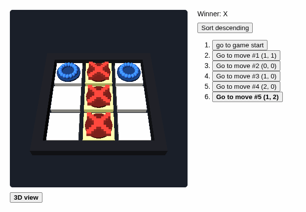
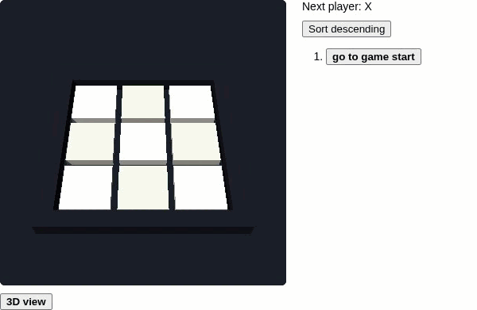
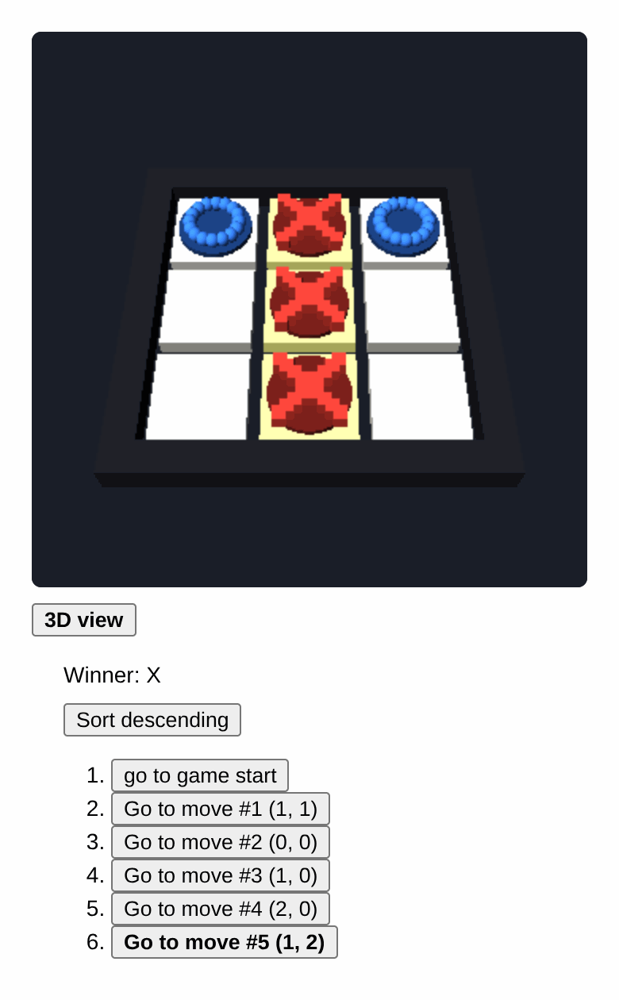
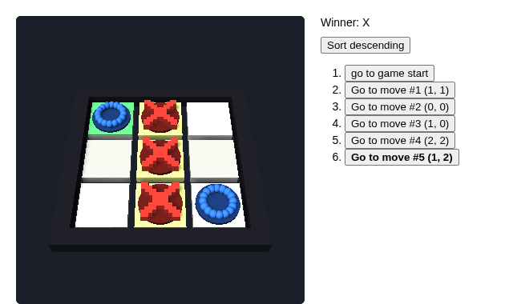

# Tic Tac Toe Web App

This web application allows two individuals to play tic tac toe with each other. This was created using a tutorial (https://reactjs.org/tutorial/tutorial.html) to gain familiarity with ReactJS.

*The board in 3D, drawn by [Strata](https://github.com/Preponderous-Software/strata)'s grid relay, after X has won (see "Play in 3D or 2D" below).*

## Play in your browser
Two players take turns on one device at https://tic-tac-toe-web.play.danielstephenson.dev, listed with the rest at [danielstephenson.dev/play](https://danielstephenson.dev/play). Pushes to `Main` build it and deploy it to [arcade](https://github.com/Stephenson-Software/arcade) (`.github/workflows/browser.yml`).

## Play in 3D or 2D
- **3D** (the default): https://tic-tac-toe-web.play.danielstephenson.dev
- **2D**: https://tic-tac-toe-web.play.danielstephenson.dev/?view=2d

`?view=2d` or `?view=3d` in the address picks the board for that visit, and the **3D view** button switches between them mid-game (the choice is remembered on that device). With `?view=2d` nothing of the 3D board is downloaded.

 

*Left: a real game on the 3D board in a desktop browser, both players' moves made with clicks. Right: the same game played with taps on a phone (390 x 844). The pictures were taken from the production build (`npm run build`) in headless Chromium with Playwright, with Strata's real relay; the GIF was cut from that run's screen recording.*

## The board in 3D

Where the browser can run it, the board is shown in 3D, drawn by [Strata](https://github.com/Preponderous-Software/strata)'s grid relay: tiles in a frame, each X a red cross of blocks and each O a ring of blue beads, with the winning squares' tiles yellow as in 2D. Everything else is the 2D game's:
- a click or tap on a tile plays that square (the square under the pointer is found by casting a ray onto the tiles), and a filled square or a won board ignores it;
- the 2D board's buttons stay in the page, out of sight, so Tab and Enter (or Space) still play a square and a screen reader still reads each square's name; the focused square's tile, and the tile under the mouse, get a green slab;
- the status line, the sort toggle and the move list are the same page elements in 3D and 2D, and jumping to a move redraws the 3D board.

3D is the default; the 2D board is shown while the 3D one loads, and kept when it can't run (no WebGL 2, or over its 4 MB size limit), with the reason on the **3D unavailable** button. The **3D view** button switches between them mid-game (remembered on that device), and `?view=2d` or `?view=3d` in the address picks one for a visit; with 2D, the 3D board is never downloaded. On a phone the board fits the screen's width and taps play the tile under the finger.

`src/scene3d.js` says what the 3D board shows, which square a press lands on, and the messages it sends the relay (Strata's `web/kit/grid-relay/WIRE.md`, format 1.0); `src/Board3D.js` is the component that loads the relay, sends them and turns its input into square clicks. The relay itself is not in the repository: `scripts/fetch-strata.js` (run by `npm run build` and `npm start`) downloads it from Strata's 0.10.0 release, checks it against the release's `SHA256SUMS` and puts it in `public/strata/` (`STRATA_WEB=<an unpacked strata-0.10.0-wasm32-emscripten download>` copies it from there instead, offline). Without it the game plays in 2D.

## Achievements
The game is two people on one device, so it keeps no high score. Instead, a player signed in to [arcade-social](https://github.com/Stephenson-Software/arcade-social) (`https://api.play.danielstephenson.dev`) at https://tic-tac-toe-web.play.danielstephenson.dev unlocks two achievements: `first-game` for finishing a game (a win or a draw) and `draw` for a draw, each sent at most once per page load. Sign-in happens on arcade-social's own page, and the game never sees a password. Nothing is sent from any other address (such as `npm start` on localhost). On the live site, the client first asks arcade-social whether the player is signed in and sends nothing more when the answer is no; if that check itself fails, the unlock is sent anyway and arcade-social decides whether to accept it. Achievements are reported by the player's browser and can be forged.

The client is `public/arcade-scores.js`, vendored unchanged from arcade-social's `clients/js` and loaded by `public/index.html`; `src/achievements.js` decides what a finished game earns, and its tests (`src/achievements.test.js`) run with the rest of the suite (see [Tests](#tests)).

## Tests
The game lives in `src/Game.js` (with `calculateWinner` and `winningSquares` in `src/calculateWinner.js`); `src/index.js` only mounts it. Each of those modules, and `src/achievements.js`, has a Jest test beside it:
- `src/index.test.js` — the game mounting into `#root`
- `src/calculateWinner.test.js` — every winning line (its winner and its three squares), the squares of both lines when one move completes two, no winner on empty, partial, full, and mixed-mark boards
- `src/Game.test.js` — turns, each square's (col, row) and mark as its accessible name, ignored clicks on filled squares and won boards, win and draw status (including a win on the last square), the status line as a live region, the winning-square highlight and the winning squares' names (both lines' when one move completes two), jumping through the move history and playing on from before a draw or a win, the (col, row) move labels, the bold current move and its `aria-current` marking, the sort toggle and its countdown numbering, and the outcome each move reports for achievements
- `src/achievements.test.js` — game outcomes, the achievements each earns, once-per-page-load unlocking, that a missing or throwing client never breaks the game, that the game reports through the client `public/index.html` loads, and that the vendored client sends unlocks only from the live site, holding back for a signed-out player but not when the sign-in check fails

- `src/scene3d.test.js` — the 3D board: a press anywhere on a tile picks its square on a desktop canvas and a phone's (upright and sideways), the frame and corners pick nothing, the checkered tiles, yellow winning tiles and the highlight slab, the X and O shapes, and every message's layout read back
- `src/Board3D.test.js` — the 3D board against a stand-in relay: starting in 3D with the 2D squares kept for keyboards and screen readers, taps playing squares, presses off the board or on a filled square ignored, a win lighting its tiles, the hover and keyboard-focus slab, the move list jumping the 3D board back, every key left to the page (the relay asked for `keys: false`), switching 2D and 3D mid-game (remembered), `?view=2d` and a saved 2D choice not loading it, and a relay that can't run leaving the 2D board with its reason

`e2e/board3d.cjs` plays the production build in headless Chromium with Strata's real relay (desktop clicks, Tab and Enter, phone taps, a win, the move list, switching views, `?view=2d` never downloading the 3D board); the `Browser build` workflow runs it after the build.

Run them once with `CI=true npm test` (`npm test` alone starts the interactive watch mode). The `Browser build` workflow runs the same suite on every pull request and push to `Main`, before the build.

## To Do
The following tasks were given at the end of the tutorial.
- [x] Display the location for each move in the format (col, row) in the move history list.
- [x] Bold the currently selected item in the move list.
- [x] Rewrite Board to use two loops to make the squares instead of hardcoding them.
- [x] Add a toggle button that lets you sort the moves in either ascending or descending order.
- [x] When someone wins, highlight the three squares that caused the win.
- [x] When no one wins, display a message about the result being a draw.

## Development
The project was bootstrapped with [Create React App](https://create-react-app.dev/) and is built with `react-scripts`. After `npm ci`, the scripts in `package.json` are:
- `npm start` — runs the game at http://localhost:3000, reloading on every change and showing lint errors in the console. Achievements are never sent from localhost (see [Achievements](#achievements)).
- `npm test` — runs the Jest suite in interactive watch mode; `CI=true npm test` runs it once (see [Tests](#tests)).
- `npm run build` — builds the production site into `build/`. Two things the deploy depends on:
  - `"homepage": "."` in `package.json` makes every asset path relative, so the site works from any directory; the workflow checks that `build/index.html` loads `./static/js/`.
  - GitHub Actions sets `CI=true`, under which Create React App fails the build on any ESLint warning, so build with `CI=true npm run build` locally to catch them before a pull request does.
- `npm run eject` — Create React App's one-way switch from `react-scripts` to copied-in configuration. The project has not ejected, and the workflow relies on `react-scripts`.

Deployment is not done by hand: the `Browser build` workflow deploys `build/` on a push to `Main` (see [Play in your browser](#play-in-your-browser)).
